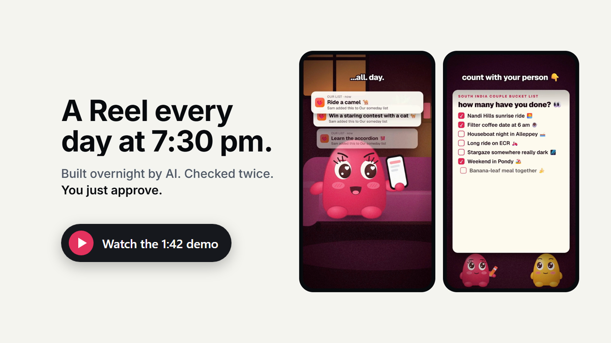
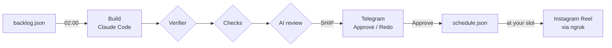

<p align="center">
  <picture>
    <source media="(prefers-color-scheme: dark)" srcset="docs/assets/logo-dark.svg">
    
  </picture>
</p>

<p align="center"><strong>Idea in. Reel out.</strong><br>Your personal AI content pipeline, running on your own PC.</p>

<p align="center">
  <a href="LICENSE"></a>
  
  
  
</p>

<p align="center">
  <a href="https://www.youtube.com/watch?v=Ntoq_75Jjow"></a>
  <br>
  <a href="https://www.youtube.com/watch?v=Ntoq_75Jjow">Watch the demo on YouTube</a> · <a href="docs/assets/pipeline-demo.mp4">download the MP4</a>
</p>

Pipeline turns a list of ideas into a Reel every day. Overnight, it builds each piece with headless [Claude Code](https://docs.claude.com/en/docs/claude-code/overview), checks it twice and sends it to your phone. You tap **Approve**, and it posts to Instagram (and optionally YouTube Shorts) at your chosen time. One install runs any number of brands, each with its own account, voice, approvers and skills, from a private admin console you can use from your phone.

It runs on one Windows PC. No servers to rent, no SaaS in the middle, no npm dependencies.

## What it does

- **Builds overnight.** At 02:00 a fenced Claude Code session makes each piece from your brief, brand voice and references, with your own skills and render tools: video, caption and cover.
- **Checks twice.** First automatic checks: the output contract, your caption and hook scripts, banned-word lists, and ffprobe on size, length and sound. Then a separate, read-only AI reviewer scores four lenses and returns SHIP or FIX. A FIX gets one automatic fix round.
- **Nothing posts without you.** Each finished video arrives on Telegram with its review summary and **Approve** and **Redo** buttons. Redo takes a note, and the next build fixes exactly that.
- **Posts on a rhythm.** Daily while enough pieces are ready, a few days a week below that. Festival and launch pieces are pinned to their date. A guard checks what's already live, so nothing posts twice.
- **Runs many brands.** Each campaign has its own folder, git repo, Instagram account, Telegram approvers, skills, schedule and time zone. Builds are shared fairly across campaigns each night.
- **A real console.** Needs you, Pipeline, Calendar, Library, Review, Health, Connections and Campaigns: play any video, approve, reorder, pin, queue builds and paste tokens. Built for touch, and private over Tailscale.
- **Built not to break.** A post-session verifier reverts anything a build changes outside its folder. Locks keep posts, builds and edits from colliding. Builds queue instead of failing. Secrets are write-only and scrubbed from every log.

## How it works



See [Architecture](docs/architecture.md) for the full picture: loops, locks, the build queue and state.

## Get started

You need a Windows 10 or 11 PC that stays on, Node 22+, Git, Python 3, ffmpeg, Chrome, Claude Code (Pro or Max, or an API key), plus free Telegram, ngrok, Tailscale and Meta developer accounts.

```powershell
git clone https://github.com/FAHADPN/pipeline.git C:\pipeline
cd C:\pipeline
npm test                                              # no install step: zero dependencies
New-Item -ItemType Directory -Force C:\Campaigns | Out-Null
Copy-Item -Recurse examples\acme C:\Campaigns\acme    # your first campaign
```

Then follow the **[Setup guide](docs/SETUP.md)**. It takes you from a fresh PC to a scheduled campaign in about two hours, most of it spent on accounts and tokens.

## Documentation

| Guide | Covers |
| --- | --- |
| [Setup](docs/SETUP.md) | step-by-step from zero to a scheduled campaign |
| [Campaigns](docs/campaigns.md) | the campaign folder, brief, voice, backlog, schedule and guardrails |
| [campaign.json reference](campaigns/schema.md) | every setting and its default |
| [Configuration](docs/configuration.md) | the owner `.env`, campaign secrets and environment variables |
| [Claude Code](docs/claude-code.md) | install, sign-in, the build and review sessions, allowlists and the verifier |
| [Skills](docs/skills.md) | `piece-review`, the Instagram writing skills and their script contract, video skills |
| [Video and TTS](docs/video-and-tts.md) | the folder contract, HyperFrames, voices (Gemini, Kokoro, ElevenLabs, HeyGen), music and mixing |
| [Instagram](docs/instagram.md) | the Meta app, tokens, refresh and how a post works |
| [ngrok](docs/ngrok.md) | why Reels need a public URL, setup, limits and troubleshooting |
| [Telegram](docs/telegram.md) | bots, approvers, Approve and Redo, client notes |
| [Tailscale](docs/tailscale.md) | private HTTPS access to the console and who can act |
| [Console](docs/console.md) | every screen and how edits stay safe |
| [YouTube](docs/youtube.md) | optional Shorts posting |
| [Operations](docs/operations.md) | scheduled tasks, every command, planning rules, state and logs |
| [Security](docs/security.md) | what protects you, and what doesn't |
| [Troubleshooting](docs/troubleshooting.md) | common problems and their fixes |

## Project layout

```text
campaigns/     campaign model, secrets, scheduler loops, task installer, schema.md
creation/      picker, build and review sessions, verifier, checks, approvals, build queue
publishing/    schedule, planner, Instagram, YouTube, ngrok file server, state, locks, Telegram
dashboard/     console server, JSON API and UI (no framework, no build step)
skills/        piece-review, the reviewer skill
examples/      acme, a complete example campaign
docs/          the guides above
```

## Tests

```powershell
npm test
```

The suite runs on Node's built-in test runner, with temporary homes, temporary git repos and fakes: no network, no Telegram, no Claude sessions and no Task Scheduler.

## Contributing

Issues and pull requests are welcome. See [CONTRIBUTING.md](CONTRIBUTING.md). To report a security problem, see [SECURITY.md](SECURITY.md).

## License

Copyright (C) 2026 FAHADPN

Pipeline is free software: you can redistribute it and/or modify it under the terms of the [GNU Affero General Public License, version 3](LICENSE), as published by the Free Software Foundation (`AGPL-3.0-only`). It is distributed in the hope that it will be useful, but WITHOUT ANY WARRANTY; without even the implied warranty of MERCHANTABILITY or FITNESS FOR A PARTICULAR PURPOSE. See the license for details.

In short: you can use, change and share Pipeline freely. If you distribute it, or **run a modified version that other people use over a network** (the console, or clients approving on Telegram), you must offer them the source of your version under the same license.

Third-party tools Pipeline works with (Claude Code, HyperFrames, ngrok, Tailscale, Telegram, and the Instagram and YouTube APIs) have their own terms. Skills you install keep their own licenses.
