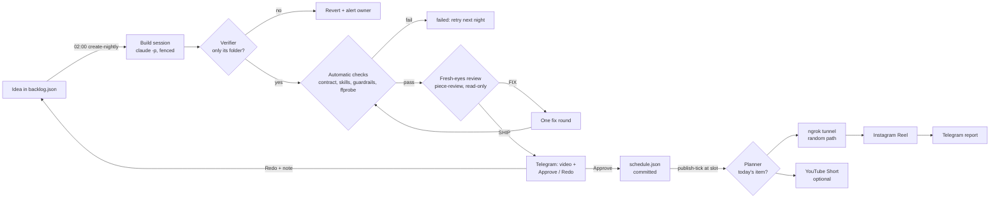

# Architecture

Pipeline is plain Node.js (ES modules, no dependencies) plus Windows Task Scheduler. Four folders, each with its own tests:

| Folder | Does |
| --- | --- |
| [`campaigns/`](../campaigns) | the campaign model (`campaign.json` loading and validation), per-campaign secrets, the three scheduler loops (`pipeline.mjs`) and their task installer |
| [`creation/`](../creation) | building pieces: the picker, build and review sessions, verifier, checks, approval handling and the build queue |
| [`publishing/`](../publishing) | posting: the schedule, planner, Instagram and YouTube clients, the ngrok file server, state, locks, logs and Telegram |
| [`dashboard/`](../dashboard) | the console: an HTTP server, its JSON API and a dependency-free UI |

## The flow



## The three loops

`campaigns/pipeline.mjs` runs one loop per invocation, over every campaign. Task Scheduler starts each one (see [Operations](operations.md#scheduled-tasks)):

- **publish-tick** (every 15 minutes): for each campaign whose posting window is open and that hasn't run today, calls `runDay` under `<id>:publish`.
- **create-nightly** (02:00): shares the night's build budget round-robin and calls `runNightly` per campaign.
- **telegram-tick** (every 5 minutes): one `getUpdates` per bot, with each update routed to the campaign it belongs to.

Each loop takes injected dependencies (`depsFor(campaign)`), which is how the tests run them with fakes. A campaign failing is caught, logged and reported to the owner. The loop moves on to the next campaign.

## Dependencies per campaign

`creation/lib/campaign-deps.mjs` and `publishing/lib/campaign-deps.mjs` turn a campaign object into everything the core functions need:

- paths, state stores and loggers,
- Telegram clients (the campaign's bot to its approvers, the owner bot for alerts),
- the session, verifier and check runners,
- lock helpers.

Core logic (`runDay`, `runNightly`, `handleUpdates`, the planner, the checks) never reads globals. That keeps campaigns isolated and every path testable.

## Locks

`publishing/lib/lock.mjs` implements file locks in `<home>\locks\` (the file for `<campaign>:<name>` is `<campaign>.<name>.lock`, because Windows file names can't contain `:`). A lock file records its holder's pid and start time, and is created exclusively. A lock older than its stale age (2 hours by default, 24 hours for builds) is taken over. The creation lock is also taken over as soon as its recorded process is gone, so a crashed build never blocks the next one. A busy lock either waits (`waitMs`) or fails with `ELOCKBUSY`.

| Lock | Held by | For |
| --- | --- | --- |
| `<id>:publish` | daily run, `post`, `ig-fetch-test`, token saves | one post at a time, and one ngrok tunnel |
| `<id>:creation` | nightly run, `recheck`, queued builds | one build at a time per campaign |
| `<id>:schedule` | **a build session, for its whole run**, approvals, console edits | nobody edits the schedule, backlog or `campaign.json` under a running build |
| `<id>:creation-state` | short updates to build status | always taken after `schedule`, so the poller and the nightly run never lose an update |

Console writes wait up to 3 seconds for `schedule`, then refuse with a message naming the build.

## The build queue

**Build now** and **Recheck** can't start while the campaign's creation lock is held, or inside a posting window (from 160 minutes before the slot until 15 minutes after the late limit). So they go into `<campaign home>\build-queue.json`: first in, first out, at most 10 entries, no duplicates. The queue is drained:

- at the end of every `create.mjs` run, by starting the next entry, and
- every 60 seconds by the console's server, which runs in your signed-in session, where builds can run.

An entry that loses a race for the lock goes back to the head of the queue.

## State and atomicity

- Every JSON state file is written to `<file>.tmp` and renamed into place.
- `state.json` is copied to `backups\` after each run (the newest 30 are kept).
- Approval edits `schedule.json` under its lock, validates it, writes it and commits it, and restores the original on any failure.
- `campaign.json` edits from the console are validated first and backed up, then written in place, keeping the file's own layout.

## Tests

Each folder has a `test/` directory of `node:test` files. They use temporary publisher homes, temporary git repositories and fakes: no network, no Telegram, no Claude sessions and no Task Scheduler.

```powershell
npm test
node --test "creation/test/*.test.mjs"      # one folder (keep the quotes)
```
